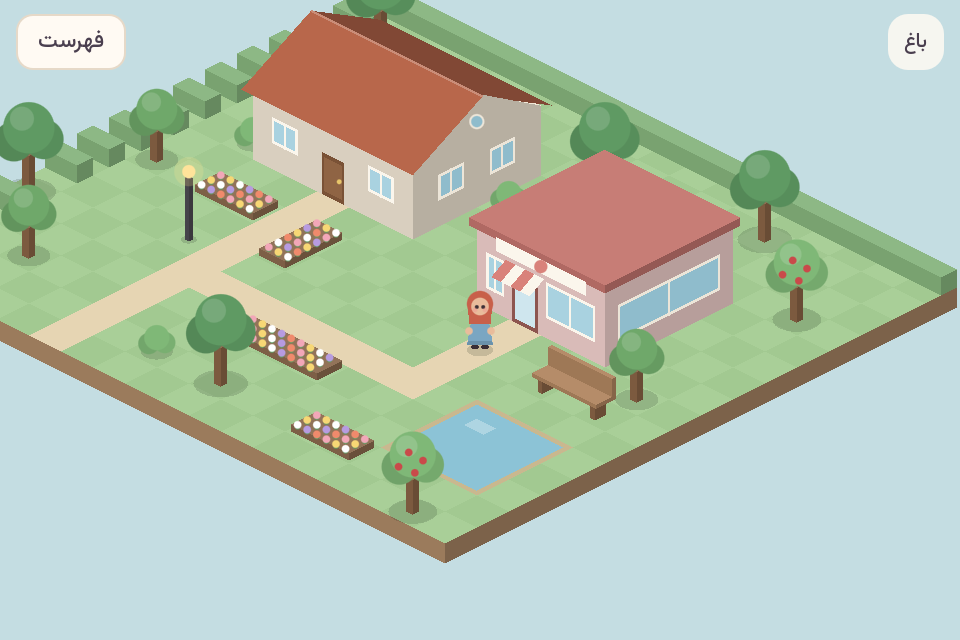
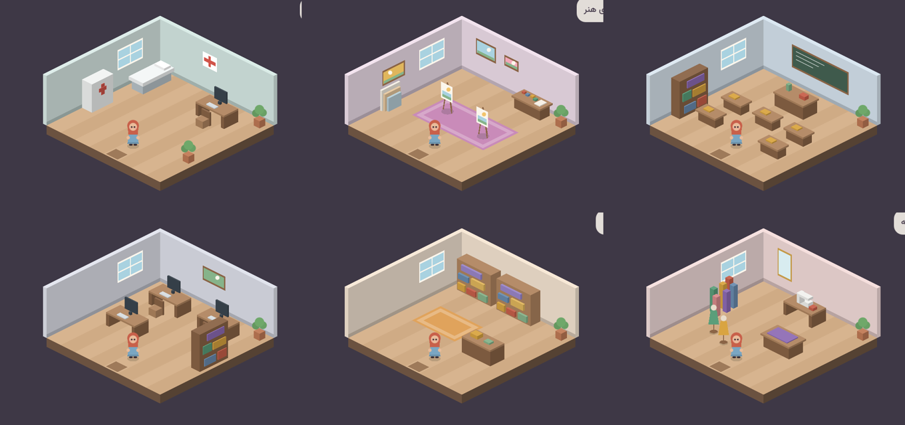
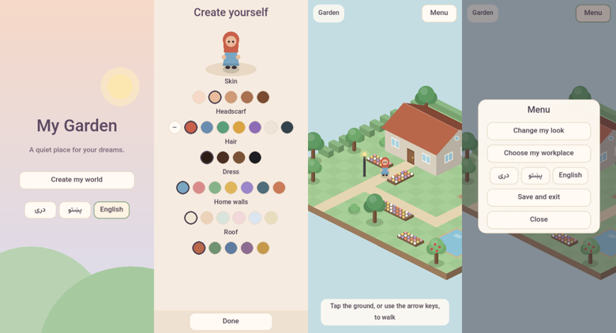

# Soul Keeper

A calm, game-like space where Afghan women build a visual world of the future they imagine — a home, a garden, a workplace of their own — and return to it over time.

> **Discretion:** the app presents itself only as **"Garden" / «باغ من» / «زما باغ»**, with a leaf icon. The project name *Soul Keeper* never appears to users. Please keep this repository private.



Built with **Godot 4.4.1** (free, open-source). It runs in a web browser now and can later be exported to Android and iOS from the same project.

---

## What works today (Phase 0 + Phase 1, plus the start of Phase 2)

| Feature | Status |
|---|---|
| Dari (default), Pashto and English, with right-to-left layout | ✅ |
| Create yourself: skin, headscarf (or none), hair, dress | ✅ |
| Choose your home's wall and roof colours | ✅ |
| Isometric garden: house, paths, trees, flowers, pond, bench | ✅ |
| Walk by tapping the ground (phone) or with arrow keys / WASD | ✅ |
| Enter the home: bed, toshak, rug, low table, bookshelf, kitchen | ✅ |
| Empty plot → she chooses her workplace: art studio, school, clinic, office, shop, or tailoring workshop | ✅ |
| Enter the workplace (each type has its own furnished interior) | ✅ |
| Saves automatically on the device only (browser storage, works offline). Nothing is sent anywhere | ✅ |
| Phone-sized layout (portrait and landscape) | ✅ |




**Not built yet (by design):** PIN lock, "Add to Home Screen" / offline install (PWA), goals, journaling, AI guide. See [docs/PLAN.md](docs/PLAN.md).

---

## Try it

### Option A: in the Godot editor (easiest)
1. Download **Godot 4.4.1** (standard version, not .NET) from https://godotengine.org/download/archive/4.4.1-stable/
2. Open Godot → **Import** → choose this folder's `project.godot`.
3. Press **F5** (or the ▶ button, top right).

### Option B: as a web page
1. In Godot: **Editor → Manage Export Templates → Download** (one time only).
2. **Project → Export → Web → Export Project** → save into `build/web/index.html`.
3. In a terminal in `build/web`, run `python3 -m http.server 8000` and open http://localhost:8000.

Every push to `main` also builds the web version on GitHub (**Actions** tab → latest run → **web-build** download).

### Sharing a test link privately
GitHub Pages needs a public repository on the free plan, so for private testing use either:
- **itch.io**: upload the zipped `build/web` folder as an HTML game, set it to *Restricted* or password-protected. It's free and needs no server.
- **Netlify Drop**: drag the `build/web` folder onto https://app.netlify.com/drop.

---

## How the project is organised

```
project.godot          Engine settings (window, language fallback, theme, autoloads)
autoload/              Always-running helpers
  i18n.gd              Loads languages from localization/, switches RTL/LTR
  save_manager.gd      Local-only save (user:// = browser IndexedDB on web), with a backup copy
  game_state.gd        The user's world as plain data; save-version migration
localization/          languages.json + one <code>.json per language (KEY → text)
scenes/main.tscn/.gd   Switches between title, avatar creator, world
screens/               Title screen, avatar creator, world screen (HUD, menu, workplace picker)
scripts/
  iso.gd               Isometric grid ↔ screen math
  iso_draw.gd          Placeholder art primitives (boxes, faces, ellipses)
  palette.gd           All colours
  avatar.gd            Draws the avatar from her choices
  furniture.gd         Furniture as data (lists of boxes); add new pieces here
  world_data.gd        Every location (garden, home, workplaces) as data
  iso_map.gd / iso_ground.gd / iso_object.gd   Builds and draws a location; A* pathfinding
  player.gd            Movement, collision, tap-to-walk
  ui.gd                Shared menu style
assets/fonts/          Vazirmatn (covers Dari, Pashto and Latin; SIL Open Font License)
tools/                 export_web.sh, build_theme.gd
```

### Common changes
- **Add a language:** add an entry in `localization/languages.json` and create `<code>.json` with the same keys as `en.json`. No code changes.
- **Fix a translation:** edit the `.json` file. *Dari and Pashto texts were written by an AI and need review by native speakers before launch, especially Pashto.*
- **Add furniture:** add an entry to `PRESETS` in `scripts/furniture.gd`, then place it in a room in `scripts/world_data.gd`.
- **Add a workplace type:** add it to `CAREERS` in `world_data.gd`, add its furniture in `_career()`, and add a `CAREER_…` key to each language file.
- **Swap in real art later:** only `iso_draw.gd`, `iso_object.gd`, `iso_ground.gd` and `avatar.gd` draw things. Replace their drawing with sprites; the data, saving and movement don't change.
- **Change menu styling:** edit `scripts/ui.gd`, then run `godot --headless --script res://tools/build_theme.gd` to regenerate `assets/theme.tres`.

### Save data
Saved as JSON at `user://world.json` (plus `world.backup.json`). In the browser this lives in IndexedDB for that site. The app asks the browser to keep it permanently (`navigator.storage.persist()`). When the save format changes, raise `SAVE_VERSION` in `game_state.gd` so old worlds still load.
