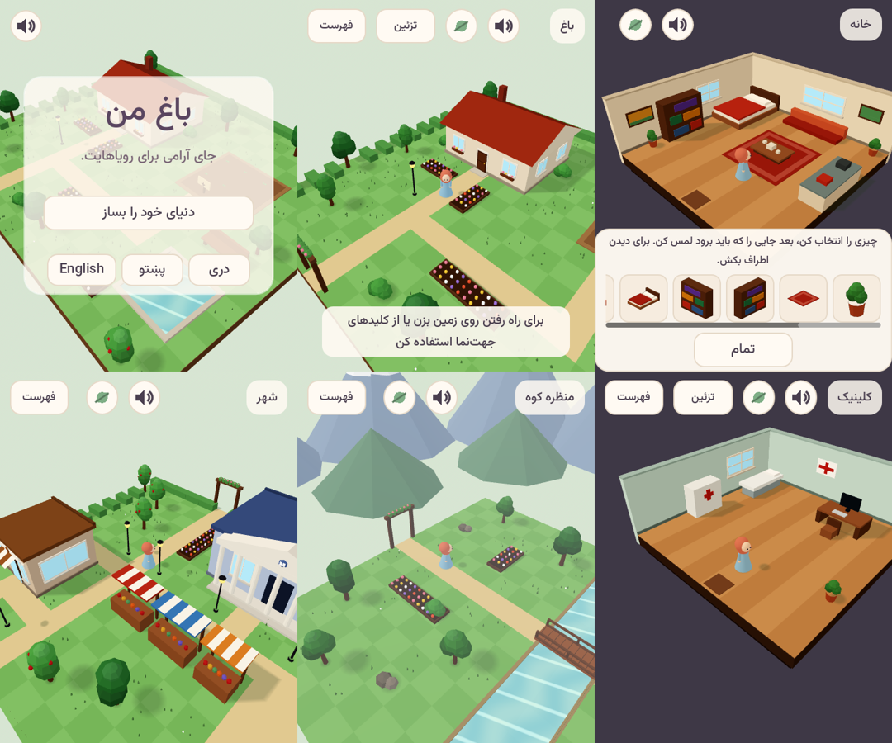
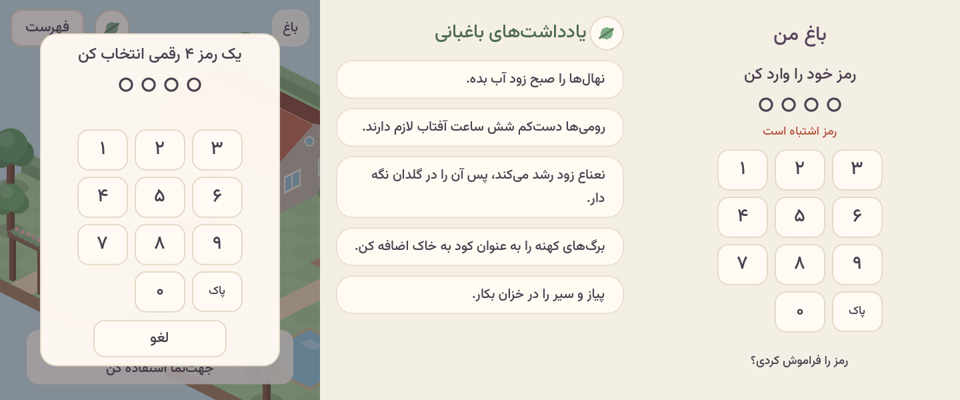

# Soul Keeper

A calm, game-like space where Afghan women build a visual world of the future they imagine — a home, a garden, a workplace of their own — and return to it over time.

> **Discretion:** the app presents itself only as **"Garden" / «باغ من» / «زما باغ»**, with a leaf icon. The project name *Soul Keeper* never appears to users. Please keep this repository private.




Built with **Godot 4.4.1** (free, open-source). It runs in a web browser now and can later be exported to Android and iOS from the same project.

---

## What works today (Phases 0–3 complete)

| Feature | Status |
|---|---|
| Dari (default), Pashto and English, with right-to-left layout | ✅ |
| Create yourself: skin, headscarf (or none), hair, dress | ✅ |
| Choose your home's wall and roof colours | ✅ |
| **3D world**: soft low-poly style, sky, warm sunlight, soft shadows, gently moving water, distant mountains | ✅ |
| 3D avatar that turns to face where she walks, with swinging arms; 3D previews in the creator and decorating tray | ✅ |
| Garden: house, paths, trees, flowers, pond, bench | ✅ |
| Walk by tapping the ground (phone) or with arrow keys / WASD | ✅ |
| Enter the home: bed, toshak, rug, low table, bookshelf, kitchen | ✅ |
| Empty plot → she chooses her workplace: art studio, school, clinic, office, shop, or tailoring workshop | ✅ |
| Enter the workplace (each type has its own furnished interior) | ✅ |
| Saves automatically on the device only (browser storage, works offline). Nothing is sent anywhere | ✅ |
| Phone-sized layout (portrait and landscape) | ✅ |
| **Town** through the garden gate: market stalls, fountain, a **university** and a **library** she can walk into | ✅ |
| **Mountain view**: snowy peaks, a river with a bridge, wildflowers and a quiet lookout bench | ✅ |
| **Decorate** her own garden, home and workplace: pick from pictures (no reading needed), tap to place, drag to look around; tap something she placed to move it, recolour it, or remove it | ✅ |
| Placement rules: nothing on doors or arrival spots, and nothing that would block the way to a door | ✅ |
| **Gentle sound**: calm music, birdsong in the garden and town, a stream at the mountains, soft taps, steps, door and placing sounds | ✅ |
| Sound on/off button (speaker icon at the top of the screen and on the title screen), remembered on the device. Quick-hide and auto-lock silence everything instantly | ✅ |
| **Optional 4-digit PIN** (Menu → Privacy). Stored only as a salted hash on the device | ✅ |
| **Auto-lock** whenever the app goes to the background (switching apps, locking the phone, changing tabs) | ✅ |
| **Quick-hide**: the leaf button (or Esc) instantly shows neutral "Garden notes" gardening tips. Tap the leaf there to come back (PIN asked if set) | ✅ |
| **Forgot PIN**: the only way back in is to start over, which erases the world, so nobody can bypass the PIN | ✅ |
| **Installable app** ("Add to Home Screen"), named only "Garden" with a leaf icon, opening full-screen | ✅ |
| **Works fully offline** after the first visit: the whole game is cached on the device | ✅ |




**Not built yet (by design):** goals, journaling, AI guide. See [docs/PLAN.md](docs/PLAN.md).

---

## Try it

### Option A: in the Godot editor (easiest)
1. Download **Godot 4.4.1** (standard version, not .NET) from https://godotengine.org/download/archive/4.4.1-stable/
2. Open Godot → **Import** → choose this folder's `project.godot`.
3. Press **F5** (or the ▶ button, top right).

### Option B: as a web page
1. In Godot: **Editor → Manage Export Templates → Download** (one time only).
2. **Project → Export → Web → Export Project** → save into `build/web/index.html`.
3. In a terminal in `build/web`, run `python3 -m http.server 8000` and open http://localhost:8000.

Every push to `main` also builds the web version on GitHub (**Actions** tab → latest run → **web-build** download).

### Installing on a phone
Open the link in the phone's browser, then choose **Add to Home Screen** (Android: browser menu ⋮; iPhone: Share → Add to Home Screen). It appears as **Garden** with a leaf icon and works without internet afterwards. The install and offline features only work over **https** (itch.io and Netlify both provide it) or on `localhost`.

### Sharing a test link privately
GitHub Pages needs a public repository on the free plan, so for private testing use either:
- **itch.io**: upload the zipped `build/web` folder as an HTML game, set it to *Restricted* or password-protected. It's free and needs no server.
- **Netlify Drop**: drag the `build/web` folder onto https://app.netlify.com/drop.

---

## How the project is organised

```
project.godot          Engine settings (window, language fallback, theme, autoloads)
autoload/              Always-running helpers
  i18n.gd              Loads languages from localization/, switches RTL/LTR
  save_manager.gd      Local-only save (user:// = browser IndexedDB on web), with a backup copy
  game_state.gd        The user's world as plain data; save-version migration
  privacy.gd           PIN (salted hash), auto-lock when the app is hidden
  sound.gd             Music, place ambience, sound effects, on/off setting
localization/          languages.json + one <code>.json per language (KEY → text)
scenes/main.tscn/.gd   Switches between title, avatar creator, world
screens/               Title screen, avatar creator, world screen (HUD, menu, workplace picker)
shaders/               World lighting, single-colour lighting, glowing glass, water
ui/                    Sound button, 3D preview stage, PIN pad, PIN setup, lock and cover screens (privacy_layer.gd), leaf button, decorating tray
tests/run_tests.gd     Automated checks (places, doors, decorating rules, saving, PIN). Also run on every push
scripts/
  iso.gd               Grid helpers (tile of a position, grid → 3D)
  map_grid.gd          A place's rules: walkable tiles, doors, A* paths, decorating checks
  mesh_builder.gd      Builds merged low-poly 3D meshes from boxes, cylinders, spheres, roofs
  object_meshes.gd     The 3D shape of every object, wall decoration, ground and soft shadow
  world_view.gd        Draws a place in 3D: sky, sun, meshes, water; turns taps into tiles
  avatar3d.gd          The 3D avatar built from her choices (walk and idle animation)
  palette.gd           All colours
  furniture.gd         Furniture as data (lists of boxes); add new pieces here
  world_data.gd        Every location (garden, home, workplaces) as data
  decor.gd             What she can place where (catalogs, sizes, recolourable items)
  player.gd            Movement, collision, tap-to-walk
  ui.gd                Shared menu style
assets/fonts/          Vazirmatn (covers Dari, Pashto and Latin; SIL Open Font License)
assets/audio/          Placeholder sounds (.ogg), generated by tools/make_sounds.py
assets/icons/          App icons for "Add to Home Screen" (generated from icon.svg)
tools/                 export_web.sh (build + offline patch), build_theme.gd, build_icons.gd
```

### Common changes
- **Add a language:** add an entry in `localization/languages.json` and create `<code>.json` with the same keys as `en.json`. No code changes.
- **Fix a translation:** edit the `.json` file. *Dari and Pashto texts were written by an AI and need review by native speakers before launch, especially Pashto.*
- **Add furniture:** add an entry to `PRESETS` in `scripts/furniture.gd`, then place it in a room in `scripts/world_data.gd`. To let her place it herself, also add its name to `INDOOR` or `OUTDOOR` in `scripts/decor.gd`.
- **Replace a sound:** drop a new `.ogg` with the same name into `assets/audio/` (e.g. a real recorded `music.ogg`). Volumes are at the top of `autoload/sound.gd`. To regenerate the placeholders: `python3 tools/make_sounds.py`.
- **Run the checks:** `godot --headless --script res://tests/run_tests.gd` (prints ALL TESTS PASSED).
- **Add a new place:** write a builder function in `world_data.gd` (copy `_hills()` or `_library()`), add it to `build()` and `PLACE_LABELS`, add a door to it from an existing place, and add a `PLACE_…` key to each language file.
- **Add a workplace type:** add it to `CAREERS` in `world_data.gd`, add its furniture in `_career()`, and add a `CAREER_…` key to each language file.
- **Swap in real 3D models later:** only `object_meshes.gd` and `avatar3d.gd` decide what things look like. A kind can be replaced by a `.glb` model (e.g. from an artist) without touching the data, saving, movement or decorating rules.
- **Lighting:** the sun's strength and direction are in `world_view.gd` (`light_energy`) and `object_meshes.gd` (`SUN_DIR`, which drawn shadows follow). Real-time shadow maps are deliberately off: WebGL rendered them with washed-out colours, and drawn shadows are faster on phones.
- **Change menu styling:** edit `scripts/ui.gd`, then run `godot --headless --script res://tools/build_theme.gd` to regenerate `assets/theme.tres`.

### Privacy notes
- The PIN keeps out someone who picks up an unlocked phone. It is **not encryption**: someone with technical skills and the device could still read the saved world. Encrypting the save is a possible later step.
- Auto-lock and quick-hide pause the world underneath, so nothing moves or saves while covered.
- The web page tells search engines not to index it. The app makes no network requests after loading.

### Save data
Saved as JSON at `user://world.json` (plus `world.backup.json`). In the browser this lives in IndexedDB for that site. The app asks the browser to keep it permanently (`navigator.storage.persist()`). When the save format changes, raise `SAVE_VERSION` in `game_state.gd` so old worlds still load.
